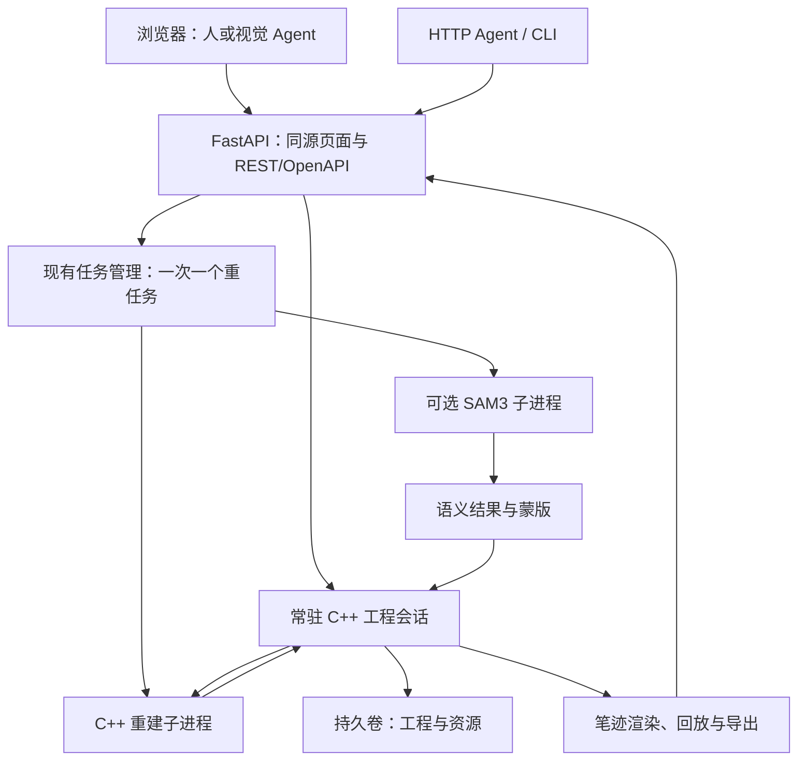

# Drawborad：Linux 云端绘画与跨平台 Agent 架构

起草：2026-10-29；复核：2026-10-31（America/New_York）。依据：用户本轮明确纠正的平台目标。状态：**完整架构建议；未宣称下述新增能力已经实现、部署或验收。**

## 1. 目标与本次纠正

用户要的是运行在 Linux 云端、能被 Work Mode Cloud Browser 以及其他平台浏览器或 Agent 使用的分图层绘图器。Windows 是后续适配目标，不是云端版本的前置条件。不能再把“给 Windows 用户临时租一台 Linux 机器做测试”当作产品定位。

此前 `2026-10-29-runnable-readiness-v6-design.md` 的 Windows 优先顺序、工期和“先改六个桌面笔刷文件”建议全部停止作为本轮执行依据。历史桌面需求保留参考；遇到平台、交付形式和优先级冲突时，以本文及用户本轮指令为准。原先的画质、分层、可编辑和可复现目标不因改成云端而被自动视为完成或取消。

首个完整用户流程：打开云端地址 → 上传图片或创建空白工程 → 查看对象与图层 → 接受所选对象并生成真实笔迹，或手动画笔 → 保存工程 → 时间回放 → 导出。无 GPU 时，空白绘画、已存在工程的编辑回放、已导入分层结果应可用；自动语义分割仅在真实模型可运行时开放。

以下是本方案的实施默认值，**是设计建议，不是用户已经确认的条件**：首版为单个所有者的工作空间、单个 Linux 实例、一个活动编辑工程；浏览器与 Agent 共用该工作空间并顺序操作。多个工程可保存和重新打开。公共多租户 SaaS、多人同时协同编辑、平台专用机器人均不纳入这次基础架构实现。

## 2. 已核实的基础与真正缺口

源码基线为 `work/cloud-agent-runtime-20261028`，提交 `a6219664c21a391ed4538ef78ccb2ae314b497be`。本地审阅快照的 356 个文件 blob 与该提交全部一致。2026-10-31 重新读取远端分支，云端与旧设计分支 HEAD 均未变化。`main` 仍只有 README；不能从 `main` 的内容判断实际开发进度。

| 部分 | 已有实现与证据 | 尚未成立的结论 |
| --- | --- | --- |
| 云端服务 | `cloud/app.py`：FastAPI、REST/OpenAPI、持久化任务、取消、访问令牌 | 尚无可编辑工程 API、笔迹输入或 C++ 绘画连接 |
| 浏览器 | `cloud/static/index.html`：上传、任务轮询、蒙版图层显示、下载 | 当前画布是叠放的图片；图层隐藏只改变 DOM，不改变导出 |
| 导出 | `cloud/exports.py`：原图像素按蒙版裁切，输出 PNG/ORA | 裁切层不等于重新绘制的笔迹层 |
| CPU 容器 | GitHub Actions run `40675320873`，对应上述提交，成功 | 只验证现有 CPU 云端工作空间，不证明新增架构 |
| 自动测试 | 该次 CI 记录 `15 passed, 1 warning`，且真实启动 CPU 容器，经 HTTP 下载检查 ORA | synthetic fixture 不能作为真实 SAM3 或重建质量证据 |
| C++ 核心 | `Document`、命令、存储、笔刷、渲染、回放和重建源码已有 | Linux 完整 headless 工作流尚未接通 |
| Linux worker | `DrawboradWorker --stdio` 目前只是协议探针 | Windows `--pipe` 的实际任务逻辑不能直接当成 Linux 功能 |
| GPU 推理 | SAM3 脚本、GPU Dockerfile、Compose 配置存在 | 没有已核实的 GPU 容器启动与真实图片推理验收 |
| v6 HTML | 预置约 63 万条笔迹、分层、工具、时间轴的交互参考 | 不是任意图片重建算法，也不是独立于 HTML 载荷的通用工程格式 |

CI 证据：[运行记录](https://github.com/DropNowOfficial/Drawborad/actions/runs/40675320873)，[具体日志](https://github.com/DropNowOfficial/Drawborad/actions/runs/40675320873/job/122772282451)。这些是已有执行证据，本次架构梳理没有重新运行这次 CI。

## 3. 方案比较与推荐

| 方案 | 对现有代码的影响 | 对目标的适配 | 结论 |
| --- | --- | --- | --- |
| FastAPI + 浏览器 + Linux headless C++ | 延用 Python、原生 HTML/JS、CMake、现有绘画核心；补服务适配 | 浏览器和 HTTP Agent 共用工程；CPU/GPU 可按能力部署 | 推荐，本设计以此展开 |
| C++/WASM 浏览器引擎 | 新增仓库未使用的 WASM 工具链、浏览器文件与线程适配 | 本地笔刷反馈可更接近核心，但仍需服务端模型任务 | 先测推荐方案的实际延迟，再决定是否值得投入 |
| Linux 图形桌面 + 远程桌面画面 | 需要移植 Qt 图形层、显示服务和远程桌面 | 可做坐标操作，但不自然提供工程与任务 API | 不作为跨平台 Agent 产品的主线 |

首版采用一个服务应用加本机子进程，避免把现有项目拆成多个网络微服务。无需引入 React、Redis、Celery、PostgreSQL、Kubernetes 或新的打包工具。这里的子进程边界用于复用 C++ 与隔离耗时模型任务，不是分布式系统设计。

## 4. 总体结构

图中箭头表示数据或任务关系；浏览器只连接 FastAPI，不直接连接 C++、模型端口或卷目录。SAM3 输出蒙版，C++ 将被接受的对象与蒙版转成工程，再产生笔迹。模型不拥有工程最终状态。

### 模块边界

| 模块 | 唯一负责的工作 | 延用代码 | 需要补齐 |
| --- | --- | --- | --- |
| 浏览器客户端 | 输入采样、视口、选层、任务进度、临时绘制反馈 | `cloud/static/index.html` | Canvas、工程编辑、时间轴、服务状态显示 |
| HTTP 服务 | 外部请求入口、认证、文件上传下载、任务元数据、调用引擎 | `cloud/app.py` | 工程路由与薄引擎客户端 |
| 工程会话 | 当前 Document、命令应用、撤销重做、保存状态 | `apps/studio/ApplicationController.*`、`src/core` | 无 GUI 的会话入口；不复制桌面控制器 |
| 语义输入 | 图片/分层包校验、SAM3 结果读取、明确数据来源 | `cloud/manifest.py`、`tools/models/sam3_semantic.py` | 规范化结果到 C++ 类型的适配 |
| 重建 | 接受对象、从参考图规划笔迹、生成可提交结果 | `ReviewSession`、`ReconstructionJob.*` | Linux 可执行入口、审阅结果转命令的共享函数 |
| 渲染与回放 | 按工程版本、事件上限或时间生成像素 | `ReferenceRenderer`、`ReplayEngine`、`PaintedDocument` | 服务接口和小尺寸预览 |
| 保存与导出 | `.draw` 编解码、已有文件保存机制、笔迹像素导出 | `ProjectStore`、`ProjectCodec`、`ExportService` | 服务侧路径映射与下载入口 |
| 部署 | 同一个应用的 CPU/GPU 变体、持久卷、可达地址 | Dockerfile、Compose、现有 CI | 编入 Linux 引擎，增加跨机器访问验收 |

## 5. 数据归属、保存和恢复

### 工程状态只有一个权威来源

C++ `DocumentSnapshot` 中的 `nodes/resources/eventIndex/spec/revision` 是绘画内容的权威状态；`.draw` 是持久化格式。浏览器保存的勾选状态、Python 的任务 `status.json`、SAM3 manifest 都不能成为另一套工程数据模型。

每条笔迹保存目标对象/层、工具、颜色、样式、输入轨迹、时间、seed、engineVersion。采用现有字段，不新增另一套 JS 笔迹格式。事件种子和引擎版本用于可复现；不承诺未经验证的跨 CPU、跨版本像素完全一致。

语义 manifest 是导入中间结果；其中的原图和蒙版允许用于分割、审阅、重建和继续细化。已生成工程的笔迹回放与导出只消费事件、蒙版及工程资源。移走参考图并禁用模型后，已保存的重建画面仍须可回放。继续重建或细化则可以明确要求重新关联同一原图。

首版保留两类导出并在名字与 API 上区分：`source-cutout` 是现有语义图层下载，`painted-project` 是新工程的笔迹渲染结果。不得把原图裁切下载按钮改名为“重建完成”。

### RGB 色彩配置的传递

首版保留 RGB8 源图的嵌入 ICC，不静默删除或改变像素色域。`RasterReaders` 已返回 `InputInfo.icc/iccProfile`，而 `runReconstructionJob` 要求源图 profileId 与工程一致；现有桌面 accept 创建默认空 profile 工程，因此普通带 ICC 的图片可能在重建入口失败。新适配不能复制这个缺口。

由原生图像解码入口提供权威的 profile 标识/字节，建档时设置 `NewDocumentRequest.colorSpec.profileId`，将 ICC 作为现有 `ResourceKind::Profile` 资源保存在 `.draw`。Python 规范化输入传递资源引用，不另写 ICC 解析器。重开工程从资源恢复 ProfileStore；预览 PNG、ORA 中的 PNG 和合成图通过已有 `RasterEncodingOptions.iccProfile` 带回相同配置。无 ICC 的图片/空白工程沿用未标记 RGB 的现有语义，并在浏览器按 sRGB 显示，不伪造原图色彩配置。

手动取色输入明确标记为浏览器 sRGB；带 ICC 工程需要转换时复用现有 `ColorService`/LCMS2，并把其已有依赖纳入 Linux 构建验证。用于转换的 sRGB 配置由现有 LCMS2 能力生成，不假造哈希。转换不可用时明确报告该能力不可用，不只换 profileId。首版不增加 CMYK/软打样功能。

P0 增加一个带合法 RGB ICC 的小图片，验证建档→重建→保存→移走原图→重开→预览/导出的 profile 标识与配置字节保留；P2 再验收浏览器取色转换。图像解码与 ICC 类型验证仍由原生入口负责，不在 Python 和核心里各复制一遍。

### 首版导出契约与已确认缺口

首版 PNG 是当前工程的合成画面；ORA 是按正确前后顺序排列的独立绘制叶子层，名称包含对象/阶段。完整对象树、蒙版编辑能力和笔迹仍保存在 `.draw`；首版 ORA 不承诺嵌套组或独立可编辑蒙版。

已有 `ExportService::write` 将 `PsdLayerPixels` 转成 `ArchiveLayer` 时未传递 visible、mask、sectionType；直接接上会让隐藏层重新显示、蒙版区域漏出、组标记变成空白层。这是已确认的正常导出路径问题，并非低概率边界。P0 必须补窄范围转换：只输出绘制叶子层，按已有 `nativeMaskedTile` 语义将蒙版合入导出副本的 alpha，传递祖先与本层共同决定的可见性及层透明度，按 ORA 栈顺序输出，跳过组边界。只使用现有支持的 Normal 合成和组约束。

验收时解码导出的 PNG 图层并按 stack.xml 合成，与同 revision 的权威 PNG 比较；含隐藏对象、局部蒙版、两层覆盖夹具。该接线预计涉及 2–3 个实现/测试文件、约 80–160 行代码，属于待实施估算；不扩展 PSD 或重写归档编码器。

### 会话与持久化的明确语义

使用一个常驻的 C++ 会话进程持有当前工程与撤销栈。若每次 HTTP 操作都新开进程再载入 `.draw`，`Document` 的内存 undo/redo 栈会丢失，因此不能将一次性 CLI 当成完整编辑会话。

- 每次成功编辑返回 `revision`，标记工程 dirty；响应表示“已应用到会话”，不是“已落盘”。
- 显式保存使用现有 `ProjectStore::save`；成功后返回 `saved_revision`。保存失败保留内存编辑与 dirty 标记，用户可重试或下载当前快照。
- 刷新浏览器重连同一服务器会话，撤销仍可用；打开另一工程会重置当前会话撤销栈。
- 服务或引擎重启恢复最近一次成功保存的 `.draw`，已有 `.bak/.journal` 按现有存储规则处理。首版不宣称未保存编辑或撤销栈跨重启保留。
- 首版不启用每笔自动写日志；现有 `appendJournal` 会读取和重写日志，需先测成本再决定自动保存策略。显式保存和“未保存”显示属于首版功能。
- 切换工程时若 dirty，界面提供保存后打开/放弃未保存更改；API 返回 `unsaved_changes`，调用方显式保存或显式选择放弃后再切换。

持久卷中新增 `projects/<project-id>/`，其中保存 `project.draw` 和可选参考资源；任务继续使用已有按 UUID 分目录的布局，避免顺带迁移旧任务。项目列表可以读取项目目录中的轻量元数据；内容仍以 `.draw` 为准。任务状态继续使用现有文件机制，不引入数据库。

## 6. Linux 引擎接通方式

### 构建与可复用逻辑

当前 `drawborad_workflow` 被包在 `if(DRAWBORAD_DESKTOP)` 内，但关键工作流只直接依赖 Qt Core。第一步把 headless 工作流构建与桌面构建分开，让 Linux 能链接 `ReviewJob/ReconstructionJob/PaintedDocument`。桌面 QML、Qt Quick、D3D11、DXGI 不进入云端镜像。

保留仓库已有 Qt Core JSON/文件使用，不为了“纯 C++”重写一遍。Linux Qt Core 的实际可用版本必须在首个构建切片里选定并记录；Windows 分支的 Qt 6.12 桌面约束不直接复制到 Linux。若需要改构建依赖的版本，只改必要声明与对应容器源头，记录构建结果。

`ApplicationController` 已有非 GUI 的建档、打开、命令、保存、撤销重做能力；优先复用。空白工程沿用 `QtBridge::initializeCanvas` 的正常文档结构：一个 Artwork 对象、一个无蒙版的 paint 层，不需要图片或 SAM。将此建档命令构造移到两端可复用处，避免浏览器空白画布必须先做语义分割。`WorkflowController::accept` 中“审阅对象转工程命令”代表可清楚命名且需要两端复用的概念，可从桌面控制器提取共享实现。不能把整个 Qt GUI 控制器搬进 HTTP 服务，也不在 Python 重写该业务逻辑。

`runReconstructionJob` 负责计算，`reconstructionCommand(before, after)` 负责将结果转成现有命令，`renderPaintedDocument` 负责无需源图的渲染。复用这些边界。遇到 `.toStdWString()` 等文件路径转换，针对真实 Linux UTF-8 路径和用户中文文件名修正并验证，不进行无关平台层重写。

### 进程与通信

建议在现有 worker 程序旁补两个明确入口角色，可使用同一可执行文件的不同 mode：

1. 常驻工程会话：接收打开、新建、命令、撤销、保存、渲染、准备重建输入及提交结果。
2. 一次性重建任务：读冻结的输入快照，调用现有计算函数，将 delta 写到任务目录；可由现有 Python 任务管理终止。

会话采用进程私有 stdin/stdout 的逐行 JSON 控制消息，Qt Core 和 Python 标准库均已具备解析能力。请求包含 `request_id/method/params`，响应包含相同 id 和 result/error；日志走 stderr。大图片和快照通过服务管理的文件传递，不塞进控制消息。命令消息上限沿用现有 1 MiB 控制预算；一次笔迹批量提交超限时明确拒绝，不静默截断。

这是新增的内部适配协议，不把当前 `--stdio` 探针冒称为已实现接口。保留原有 Windows DBIPC 协议，不为首版修改其 nonce/共享映射/命名管道机制；没有浏览器或其他平台需要理解该内部协议。独立端口、gRPC、Python C++ 扩展绑定均无必要。

FastAPI 采用单个应用 worker，持有一个串行会话客户端。耗时任务复用已有单任务准入；其间允许读取任务和最近完成的预览，暂停目标工程写入，返回明确 busy。计算完成后在当前基准 revision 上一次应用现有重建命令。取消或失败不提交部分笔迹。这里复用已有版本与命令规则，不增加分布式锁或多写者合并。

引擎意外退出时，当前请求返回明确失败，界面保留最近显示画面但标记无法编辑；重新打开已保存工程后恢复服务，未保存内容按本节声明处理。不做隐式重试写命令，以免调用方不知道是否已应用。

## 7. 一次入口校验的分工

| 输入 | 入口与负责者 | 内部流转 |
| --- | --- | --- |
| HTTP envelope、认证、上传大小/文件名 | FastAPI 入口 | 已解析请求与服务分配的文件引用 |
| 外部分层 ZIP、SAM3 输出 manifest | Python 现有语义导入入口 | 规范化的图像尺寸、蒙版、对象名、来源与资源标识 |
| 笔迹、图层命令的领域字段 | C++ 会话命令入口 | 确定类型的 Command/InputSample/StrokeStyle |
| 外部 `.draw` 文件 | C++ ProjectStore/ProjectCodec 载入入口 | DocumentSnapshot |
| 内部生成的重建结果 | 现有 reconstructionCommand 接受边界 | 可应用的 Command |

Python 不再给笔迹的每个领域值做一遍与 C++ 重复的校验。已验证语义结果走规范化内部接口，不再调用 `loadSemanticMaskManifest` 重读同一个原始包、重复做全套图像哈希和覆盖校验。内部跨语言解码仍要把传输值转换成类型，但不复制入口的业务验证。工程层已有锁定层、目标存在、版本匹配等命令规则保留，它们决定操作是否合法。

现有 Python 导出会反复 `load_manifest`，这是已查到的重复工作；接通新工程路径时避免照搬。不要以此为由顺带清理全部旧导出、ProjectStore 或底层防御检查。

Python 当前允许 `sam3-image` 和 `fixture-no-ai`，C++ 旧 manifest 读取器只允许前者。新规范化入口必须保留来源标签；测试 fixture 经明确的 fixture 路径进入，不改写标签冒充真实模型。已有 `.draw` 导入也不能把内部任务元数据当作可执行指令。

## 8. 用户界面与操作路径

延用现有原生 HTML/CSS/JS，先补交互，不先换前端框架。产品界面表达任务与作品，不展示内部队列、进程或路径细节。

- 中央画布：缩放、平移、选层绘制；原图参考是可开关的辅助视图，与最终作品分开。
- 工具区：先暴露核心确实实现的画笔、橡皮、颜色、大小、透明度。v6 六个工具名不等于核心已有六种完整材质。
- 图层区：对象/绘制层、选择、可见性、锁定、命名、顺序；所有修改发工程命令，保存和导出读取同一状态。
- 时间轴：播放、暂停、定位到时间或事件；新手动笔迹也进入同一事件线。新笔迹的时间安排在现有最大时间之后，轨迹内使用相对时间；不直接把浏览器会话时间混入已有重建时间轴。
- 顶部工程操作：新建、打开、保存、下载工程、导出；显示“未保存/已保存”的明确状态。
- 任务区：上传/对象提示、分割、接受对象、开始重建、取消、失败原因；明确区分“分割完成”和“绘画完成”。

同一个业务动作既有可访问的 DOM 控件，也有 API。表单具有 label，按钮具有明确名称，状态在 DOM 中可读；视觉 Agent 不必猜画面坐标才能识别任务是否完成。

### 绘制与播放的延迟策略

浏览器在拖笔时用轻量 Canvas 轨迹显示即时反馈，结束一笔后批量提交采样点；C++ 输出权威预览后替换临时轨迹。浏览器不实现第二套权威材质、随机种子或混色算法，因此临时线条与最终材质可能存在差异，需要实际体验验收，不能声称已经与本地桌面同样流畅。

首版按完整小尺寸预览更新，复用核心的脏区信息但不提前实现网络瓦片系统。回放定位使用工程 revision + event/time 上限；播放按顺序请求预览帧，只在浏览器内预取少量帧，缓冲不足则显示等待。编辑后丢弃旧 revision 的预览。先验证定位结果与结束帧正确，再测每秒帧数和网络耗时；首版不承诺 60 FPS 或 63 万笔迹流畅回放。

测量拖笔结束到权威画面显示、保存耗时、指定事件数下的回放帧耗时和导出峰值内存。出现实际瓶颈后再讨论瓦片、压缩、缓存或 WASM，说明具体触发条件与改动量后推进。

## 9. 对外 API 与平台接入

以下路径是建议契约，**项目相关路径当前尚不存在**。已有 job 路径保留兼容，不突然改变原有 `/jobs` 上传的语义。

| 入口 | 现状 / 建议职责 |
| --- | --- |
| `GET /healthz`、`GET /api/v1/capabilities` | 已有；拆分服务在线、绘画引擎可用、模型已配置、实际推理验证状态 |
| `POST /api/v1/jobs`、`GET /jobs/{id}`、`DELETE /jobs/{id}` | 已有语义任务、查询、取消；DELETE 是取消，不是删除作品 |
| `POST /api/v1/import`、`POST /api/v1/demo` | 已有语义包与显式 synthetic fixture |
| `POST /api/v1/projects`、`GET /api/v1/projects` | 新建/从已接受语义结果建工程，以及列出工程 |
| `POST /api/v1/projects/import` | 上传已有 `.draw`，返回持久工程 ID |
| `POST /api/v1/projects/{id}/open`、`GET /api/v1/projects/{id}` | 打开为活动工程、读取状态与图层/版本/保存状态 |
| `POST /api/v1/projects/{id}/commands` | 批量笔迹或图层命令，含 expected_revision；一次操作对应一次撤销 |
| `POST /api/v1/projects/{id}/undo`、`/redo`、`/save` | 会话撤销重做，显式保存 |
| `POST /api/v1/projects/{id}/jobs` | 新增 reconstruct/refine/export 等项目任务，返回 202 + job_id |
| `GET /api/v1/projects/{id}/preview.png` | 当前已提交工程的渲染或按事件/时间定位帧；带 revision |
| `GET /api/v1/projects/{id}/download` | 下载 `.draw` 快照；明确响应所含 revision |
| `GET /api/v1/jobs/{id}/artifacts/{name}` | 项目任务的绘画 PNG/ORA 等产物下载，与现有裁切导出并存 |
| `/docs`、`/openapi.json` | 沿用 FastAPI 自动生成，不手改生成内容 |

新增工程响应至少包括 project_id、revision、saved_revision、dirty、图层树、笔迹数量、活动任务和实际能力。ID 使用字符串；核心 64 位 revision/time/seed 在 JSON 契约中使用十进制字符串，在入口转换为核心类型。坐标用工程像素，画布显示倍率和设备像素比只由浏览器换算一次。

新增错误响应含稳定 code、可读 message、必要的 current_revision；格式错误、工程不存在、busy/旧 revision、引擎不可用分开处理。未知能力不可通过按钮或 capabilities 宣称支持。`_ready()` 目前只是检查文件/包/配置，不能等同于模型已经加载并实际推理。

### 不同平台如何使用

| 平台能力 | 接入方式 | 必须实际验证的条件 |
| --- | --- | --- |
| Cloud Browser / 视觉操作 Agent | 打开同一个 HTTPS 页面，操作 DOM 或画布 | 该浏览器所在机器能访问地址并完成已有认证 |
| 能发 HTTP 的 Agent | 标准 REST + OpenAPI | 平台工具允许连接这个地址并携带令牌 |
| 有命令行的云端环境 | 现有 CLI；补充工程命令时作为 REST 薄客户端 | 已有运行环境或可访问服务的 HTTP 客户端 |
| 只支持特定插件协议的平台 | 后续增加薄适配器，调用相同 API | 先核实该平台真正支持的协议及授权方式 |

没有核实 Grok Bot 或其他指定平台的具体插件、网络、文件与认证能力，因此不写成“已接通所有平台”。本方案提供通用浏览器/HTTP 接口；若某个平台仅支持 MCP，之后再加薄 MCP 适配，而不是现在假定所有平台都必须安装同一个插件。Drawborad 本身不因供 Agent 操作而必须配置 OpenAI/Grok API key。

## 10. 任务与真实模型

沿用 `queued → running → succeeded/failed/cancelled/interrupted`。当前服务启动会把未完成任务标记 interrupted，浏览器必须把它当作终态，不再无限轮询。这个缺口来自现有代码的正常重启路径，不是假设性的极端竞态。

| 阶段 | 输入 | 输出 | 成功的含义 |
| --- | --- | --- | --- |
| 分割 | 原图、对象提示、真实模型 | 对象名/蒙版/来源 | 取得模型结果；仍需人审对象准确性 |
| 接受对象 | 选中对象和蒙版 | 工程对象与空绘制层 | 分层结构建立，尚未产生画面笔迹 |
| 重建 | 冻结工程快照、参考图 | 真实 StrokeEvent 与 delta | 计算完成且一次应用到工程 |
| 编辑 | 笔迹/图层命令 | 新 revision | 会话状态变化，尚未代表保存 |
| 保存 | 当前快照 | `.draw` | 已落盘并报告 saved_revision |
| 回放/导出 | 笔迹工程、事件/时间上限 | PNG/ORA 等 | 输出来自工程事件，不重新读原图代替绘制 |

首版 SAM3 继续由现有 Python 脚本在同一服务所在的 Linux 主机执行；GPU 是可选部署能力，不是空白绘画的前置条件。模型加载失败明确失败，不回退到 synthetic 或其他算法。显式 demo 保留 fixture 标志。真实对象归属必须单独验收，例如桌面/杯垫/杯子/勺子应由识别流程产生各自的对象蒙版；人工审阅可以拒绝或修正结果，但不能把手工重新分组当作自动识别已经正确的证据。

当前 Compose 的 `review` 与 `sam3-gpu` 是两套完整应用、两个数据卷，并非前端/远程 GPU worker 已互连。目标部署应选择 CPU 或 GPU 变体运行一个应用、一个工作空间卷、一个入口。未来确需独立 GPU 主机时，再把现有本机任务适配替换为远程执行；首版不同时实现这套分布式方案。

## 11. 部署、可达性与 Windows 后续适配

Linux 镜像包含 FastAPI、静态页面和 headless 引擎。CPU 镜像能够创建、编辑、保存、回放工程；GPU 变体在同一应用契约上增加推理依赖。权重只读挂载，不打进镜像。构建继续使用 CMake 和现有 Dockerfile/Compose，不在应用启动时编译。

部署必须明确三个不同地址：容器内部服务地址、宿主机映射地址、其他平台实际访问的 HTTPS 地址。`127.0.0.1:8765` 只能证明同机访问；Work Mode 的 Cloud Browser 不自动与构建终端共享 localhost，也不等于一个持久服务器。Codespaces 私有端口也不能当成所有外部 Agent 都可访问的公共接口。

首版由所选托管环境提供 HTTPS/入口转发，保留已有 bearer token 认证与输入限制；浏览器和 API 同源。实际交付必须从独立浏览器环境打开该地址，并从另一个 HTTP 客户端完成一项工程操作。尚未选定托管账户、机器/GPU、域名和访问策略，这不阻止架构与本地集成，但阻止宣称已完成云端部署。本轮不购买、开通或公开暴露服务。

Windows 后续的最低成本路径：在 Windows 启动同一个服务与移植后的 headless 引擎，复用浏览器 UI、REST 和 `.draw`。若以后需要原生桌面壳，再使用已有 Qt UI；图形壳不是云端前置依赖。需要验证的是 Windows 文件路径/进程、打包与相同工程的兼容性，不是重写绘画算法。Linux 与 Windows 的像素一致性由固定夹具验证，不提前宣称自动保证。

## 12. v6 的保留价值与范围控制

保留分层绘制、显隐、工具、时间轴、保存导出等交互意图，直接复用其中内嵌笔迹不是本方案的引擎路线。该附件是约 20 MB 的预生成单文件，未找到生成源头，因此不手改其载荷。

v6 项目 JSON 依赖同一 HTML 的基础笔迹数据，不是完整自包含工程；自定义笔迹也没有完整并入内置回放时间线。目标以现有 C++ 文档与事件模型统一这些语义。v6 约 63 万笔迹与当前重建任务上限 16,384、细化任务 4,096 的预算不相当，不能据此声称整份示例已迁移或性能已经达标。

首版沿用现有 RGB8 和实际内存预算。当前语义输入上限为 4,194,304 像素、边长 4096、64 个蒙版、32 MiB 源文件，同时受蒙版总量和渲染工作集限制；这些上限不是所有组合都可同时运行的性能保证。4K/8K、完整 CMYK、专业材质、遮挡补全、完美语义分割和自然绘画过程分别验收。

## 13. 实施顺序与构建距离

以下是供排期的工作量区间，按一名熟悉仓库的工程师计算，**不是有历史统计支持的概率预测**。构建依赖、实际渲染耗时和模型可得性尚未实测，首个切片后必须重新估算。不能用完成百分比代替验收证据。

| 阶段 | 具体交付与验收 | 粗估工程日 |
| --- | --- | --- |
| P0：Linux 核心贯通 | Linux 构建 headless workflow；真实核心读小型 fixture，建对象、生成笔迹、保存 `.draw`、输出开始/中间/结束 PNG 与显隐/蒙版正确的 ORA；移走原图后重开回放 | 2–4 |
| P1：云端工程会话 | 常驻进程、薄 IPC 客户端、工程命令/保存/打开/API、重建任务与取消、任务来源标签；UI/API 共用 revision | 4–7 |
| P2：浏览器基础绘图器 | 画布输入、基本工具、图层编辑、保存状态、撤销重做、时间轴；从独立浏览器地址验收 | 5–9 |
| P3：发布与实测 | CPU 镜像、持久卷重启、另一 HTTP 客户端编辑同一工程、导出复核、延迟与内存记录 | 2–5 |
| G：真实 GPU 验证 | 已有机器/权重条件下构建 GPU 镜像、运行真实图片、审阅语义结果、走到工程笔迹导出 | 另计 2–5；不含资源等待与画质研究 |

P0–P3 顺序合计约 13–25 工程日，是“可保存、可编辑、可回放的云端 Alpha”的初步预算，不保证达到 v6 展示精度或专业绘画质量。当前已有云端裁切演示可先使用，但与这个 Alpha 之间仍有上述连接工作。高保真自动重绘与自然过程不能在没有真实样本评测前给出可信完成日期。

**第一批仅做 P0**：构建边界、必要的共享工作流入口、一个 headless 端到端夹具以及对应现有测试/CI。先取得 Linux 全链路产物再展开浏览器界面。涉及文件预计集中于 `CMakeLists.txt`、`cmake/Dependencies.cmake`、`apps/worker`、必要的 `src/ui` 共享逻辑、`cmake/TestTargets.cmake` 与相应测试、CPU Dockerfile/现有云端 workflow；准确差异在实现计划中列出，不把整张路线图一次塞入一个 PR。

沿现有 `work/cloud-agent-runtime-20261028` 继承代码，不回到仅有 README 的 main 重建项目。建立专用 Linux 工作分支与现有 GitHub Actions 检查，后续决定合并顺序；不自动合并旧 PR，不修改 Windows RC1 发布内容。更新现有 cloud workflow 的 C++ 路径过滤与 headless 检查，避免改了引擎却没有执行对应检查。

## 14. 验收证据与不扩大的范围

- 使用仓库现有 C++ 测试体系、`pytest tests/cloud` 和 Docker smoke；不引入另一套测试工具。
- 测真实引擎与 HTTP 适配，使用微型可审查 fixture，不在测试里另抄算法。synthetic fixture、真实模型结果分别报告。
- 导入一次 → 建工程 → 生成非空笔迹 → 保存 → 关闭 → 移走源图 → 重开 → 0/中间/最终帧 → PNG/ORA，检查帧差异、事件数和独立图层。
- 图层隐藏、顺序、手绘和撤销必须影响同一 revision 的显示、保存、重新打开与导出；不能只检查按钮可点。
- 验证浏览器刷新与服务重启的不同保存语义，正常取消、重启 interrupted、保存失败的可见结果；不扩展为随机故障注入项目。
- 使用当前核心支持的工具测试实际压力/样式作用；浏览器没有提供的倾斜或压力能力不能凭字段存在而宣称支持。
- 同一保存工程在目标 Linux 镜像重跑比较核心像素哈希，记录引擎/依赖版本；Windows 一致性留到其适配阶段。
- 独立浏览器/HTTP 客户端的可达性与认证验证是部署证据；容器内 curl 成功不能代替它。

不新增重复校验、假想竞态锁、公共 SaaS 账号系统、跨机器任务调度或通用插件框架。若实测出现需要额外机制的问题，先给出实际触发路径、发生证据或频率未知的说明、预计改动量，再由用户决定。函数只因复用、复杂逻辑或明确概念而提取；注释只记录不明显约束；生成文件从源头重建。

## 15. 尚待实际环境提供的信息

独立构建审阅已完成；发现的 ORA 数据传递和 RGB ICC 建档缺口已分别补入第 5 节及阶段验收。

完整架构不依赖用户现在选云厂商；正式部署时需要可使用的 Linux 主机/托管账户、持续可用的访问入口，以及是否具备 GPU 与模型权重。某个具体 Bot 的连接限制必须在该平台实际验证。上述事项影响部署落点，不改变浏览器 + 通用 API + Linux 引擎的产品方向。

本次交付只修订架构、优先级和可验证的实施切片；没有修改产品实现、安装新依赖或声称已经完成 Linux 绘画服务。
