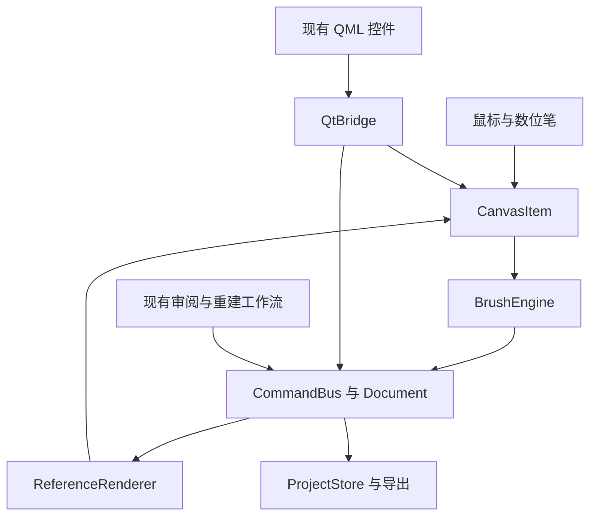

# Drawborad：可运行版本距离评估与最小实现设计

日期：2026-10-29（America/New_York）。状态：**实证评估已完成；下面的新产品改动是待审阅设计，不是已实现功能或发布承诺。**

本轮只新增本文，不修改产品代码、依赖、构建流程、生成文件、模型或历史发布分支。以现有 Windows 原生产品为目标，以用户提供的“可复现_分图层绘图器_v6.html”为行为参考。没有把 HTML 重写为另一套产品，也没有把云端分层演示算成原生绘图软件。

## 1. 结论与证据边界

已经存在可复用的文档、命令、存储、笔刷、回放、图像格式与重建核心；主要问题是原生交互没有完整接通，以及 Windows/真实模型/质量验收尚未闭合。不能用代码量、分支数量、单元测试通过率换算“完成百分比”。

| 要交付的版本 | 已有依据 | 目前缺口 |
| --- | --- | --- |
| 能打开窗口的 Windows UIOnly 候选 | Qt/C++ 桌面源码、现有 PowerShell 打包脚本 | 没有核实到成功的 RC1 Windows 构建和程序 ZIP；需要目标工具链与真实启动 |
| 日常可用的基础分层绘画 Alpha | 笔迹事件、命令撤销、原生工程、图层与渲染核心 | 笔刷参数接线、绘制中反馈、图层编辑入口、时间回放、实际 Windows 验收 |
| 图片 → 审阅 → 重建 → 分层导出 Alpha | 原生工作流、SAM 2.1 适配；另有 SAM3 草稿分支 | 真实模型与图片完整走通、可接受的运行时间、打包后的端到端验收 |
| 原需求中的专业离线产品 | 已有需求和不少底层实现 | 高保真、自然过程、4K/8K、64/128 层、CMYK 显示、设备、Photoshop、离线模型分发等各自未完成验收 |

“基础分层绘画 Alpha”是建议的中间交付点，**不降低原产品要求，也不代表用户已经同意缩减最终范围**。

### 当前读取的版本

所有 GitHub 链接固定到实际读取的提交；之后分支前进应重新核对相关差异。

| 分支 | HEAD | 实际定位 |
| --- | --- | --- |
| main | `9b9416871f4fff988f8f841e56795d5251dc3f9c` | 只有 README；不能据此判断整个项目为空 |
| release/win11-integrated-alpha-rc1 | `5b23ca684dc021ccf7a8a3e7dfc87e7c80e7a5c3` | 本轮原生基线；现有源码和本地构建记录匹配 |
| work/native-sam3-semantic-20261027 | `ba81ca21caba8d3363611a6d3b8e67392db403fd` | 比 RC1 前进 18 个提交，背后 0 个；PR #2 尚未合并 |
| work/cloud-agent-runtime-20261028 | `a6219664c21a391ed4538ef78ccb2ae314b497be` | 比 SAM3 原生分支前进 28 个提交，背后 0 个；PR #3 尚未合并 |

这三条开发线是可核对的继承关系，不需要先把所有历史实现分支盲目合并。

### 本轮与历史验证分开报告

- 本轮重新运行 RC1 已有 Linux 测试二进制：`R03` 2、`R04` 2、`F03` 14、`C04` 52、`C05` 28，共 **98 个用例、0 失败**。调用的是仓库原有测试程序，没有复制业务逻辑或新加 mock。
- 通过仓库现有 `tools/qa/release_report.py::source_identity` 比较，当前 RC1 的提交、Git tree、源码指纹与保存的执行收据一致，工作树干净。源码指纹：`b8025a0870c886d9deda357ee5d710f7c8460309ea1a4f4640d799887370233f`。
- 这次是**复跑现存二进制**，不是从零构建；当前环境缺少原构建所用的 CMake/Ninja 安装、Windows/MSVC/Qt。历史的 45 项 portable / 48 项 synthetic-ORT CTest 结果不冒充本轮全量测试。
- 云端 [Actions 40675320873](https://github.com/DropNowOfficial/Drawborad/actions/runs/40675320873) 的真实日志显示 **15 passed**，CPU Docker 构建成功，容器 HTTP 的健康检查、能力接口、合成演示和 ORA 下载成功。产物是明确标为 `fixture-no-ai` 的四层合成样例；这不证明真实 SAM3 推理。
- RC1 分支 Actions 查询结果为 0 次运行；仓库 [RELEASE_STATUS](https://github.com/DropNowOfficial/Drawborad/blob/5b23ca684dc021ccf7a8a3e7dfc87e7c80e7a5c3/reports/windows-rc1/RELEASE_STATUS.md) 同时记录 Windows 应用 ZIP 尚未产出。未检查用户电脑，不能断言用户本地没有程序。
- 历史 SSIM 0.6487 未达到既定 0.98；本轮没有新图像质量测量。它不能换算成“65% 完成”。
- 云浏览器访问本地附件分别遇到 `ERR_BLOCKED_BY_CLIENT` 和 `ERR_CONNECTION_REFUSED`。因此没有当前 UI 截图、交互实测或可访问性审计结论；下文有关 UI 的结论来自源码，不伪称视觉验收。

## 2. HTML v6 能证明什么

附件原文件 19,811,654 字节；SHA-256：

`f3fdcbdc19c44d608790ac0a59a7ef1dd753d3acf7313b5092889c5cf853a952`

直接解析其内嵌数据得到：**630,340 条笔触、109 个组、326 秒、12 个内置阶段层和初始 1 个用户层**。元数据明确写的是合成的参考引导笔触，不是恢复的人类创作历史。解压的笔触二进制为 23,993,228 字节。

它可作为六类笔刷入口、分层操作、参考图、项目保存、播放/拖动和导出的体验清单。它不包含通用图片分割或图片到笔触的生成器；`importRef` 只是参考图导入。它的 JSON 依赖同一 HTML 内的基础笔触载荷，并不是独立完整的 .draw 替代格式。

以下是可从源码直接确定的差异，不是已做浏览器复现的结果：

| 位置 | 明确问题或限制 | 对本项目的影响 |
| --- | --- | --- |
| HTML 第 33、40、63、73 行 | 显示 canvas 是 1488×1948；`SCALE=1` 令图层为 744×974；合成以原尺寸写入，指针却按 744×974 换算，没有补偿这两套尺寸 | 不能把现有显示/坐标实现直接作为正确参考；须统一逻辑尺寸与渲染尺寸 |
| 第 65 行 `renderAtTime` | 每次时间定位新建临时层并从第 0 条重画到目标；用户笔迹整层叠加，不参与内置时间轴 | 不是适合直接移植的播放实现；具体帧率尚未测量，不声称必然卡死 |
| 第 77、94 行 | 绘画后删除该用户层，撤销栈仍引用已删除层；`undo` 随后访问不存在的 `l.strokes` | 这是普通顺序操作可到达的历史管理问题，不需要并发 |
| 第 84、86 行 | 导入项目不重置历史栈，也不恢复 `strokeSerial`；`basePayloadSHA` 被输出但未用于匹配载荷 | 项目导入的会话状态不能照搬到原生核心 |
| 第 69、74、75 行 | 记录 pressure，但绘制宽度/覆盖没有使用其值 | 不等于已实现数位笔压力绘画 |

没有找到这份 HTML 的源生成器。本轮保持附件原样，不手改内嵌载荷或把生成产物拆成新的维护源。若以后要维护 HTML 本身，应先定位生成源；这不是当前原生交付的前置任务。

## 3. 原生产品的具体缺口

| 缺口 | 当前源码证据 | 正常使用的后果 | 建议处理 |
| --- | --- | --- | --- |
| 笔刷参数没有接通 | `CanvasItem::finishStroke` 固定 toolId=pencil、width=12、opacity=1、固定颜色 | 用户无法像 v6 一样控制手绘工具、颜色、尺寸、透明度 | 复用现有 BrushSettings，把界面参数传给现有 BrushEngine |
| 拖动期间没有笔迹预览 | `appendSample` 只追加采样；画布更新渲染已提交 snapshot，提交发生在松笔 | 当前源码路径缺少边画边看的显示 | 给当前未提交笔迹增加临时预览，松笔只提交一个 Paint 命令 |
| 图层编辑只接了一部分 | QtBridge 暴露 add/select/visible；核心已有 RenameNode/RemoveNode/MoveNode/SetProperties | 调名称、透明度、锁定、顺序、删除缺少完整画布图层入口 | 接通现有命令，不再做第二套图层模型和历史栈 |
| 回放以事件条数计时 | QML Timer 固定 100ms 加 1；CanvasItem 使用无限 timeTicks | 不能保留笔迹原有时长与笔迹内部过程 | 复用已有事件时间和 EventLimit，增加时间播放状态 |
| UI 显示范围小于核心格式范围 | CanvasItem 对非 RGB/U8 直接返回；UI 标注最多 400 万像素 | CMYK/16 位核心能力不能当作桌面显示已经完成；4K UHD 也超过当前 UI 限制 | 基础 Alpha 明示 RGB8；专业阶段另行接 ColorService，保持原 CMYK 需求 |
| Windows 包尚无验收证据 | 现有打包协议和 release status 明确 Blocked | 无法让用户直接下载并开画 | 用已有 Build-Alpha.ps1 完成实际 Windows 构建和解压启动 |

例如 630,340 条事件若在当前“每 100ms 一条”的原生定时器中播放，将需要 63,034 秒（约 **17.5 小时**），而不是 326 秒。这是现有计时方式的算术示例，**不是已实现 v6 导入或做过该规模实测**。原生和 v6 的笔触数量、渲染算法不可直接等同。

## 4. 架构方案

### Approaches

1. **沿用 Qt/C++ 原生架构，分阶段接通现有能力——推荐。** 符合现有 Windows、离线、模型、文件格式和测试体系。优先拿到真实 Windows 运行证据。
2. 浏览器优先，把 v6 接入 cloud UI。能更早展示局部体验，但需要新的浏览器绘图状态/历史/格式桥接，且不能完成当前原生、离线、数位笔与专业色彩要求。只有用户改变首版目标才重新评估。
3. 改用 Electron/WebView 或重写。引入新工具与双重核心，直接违背本次“沿用仓库流程、限制改动范围”的约束，不纳入实施。

本设计延续仓库已记录的原生方向；HTML 的外观不是本轮重新设计主题、框架或产品定位的授权。

### 数据流：一个文档与一份笔迹事实

输入、命令、文件读取仍走各自已有入口。QML 不持有另一套图层/笔迹事实；历史仍由 CommandBus 管理；工程仍使用 .draw；不新增 JSON 数据库、服务层、事件总线或浏览器桥。

| 已有所有者 | 建议增加或接通的职责 | 不需要的新抽象 |
| --- | --- | --- |
| QML + QtBridge | 显示与提交画笔设置；从字符串/数值 UI 输入转换一次到 BrushSettings 的字段 | 通用表单框架、参数仓库 |
| CanvasItem | 按下时固定本笔设置与目标；移动时显示预览；松笔交给原 BrushEngine | 第二套画笔引擎 |
| BrushEngine / StrokeEvent | 保留颜色、工具、宽度、透明度、seed、采样时间 | 新笔迹文件格式 |
| CommandBus | 图层名称/顺序/锁定/透明度/删除均用已有命令，进入同一撤销链 | 手写 undoStack/redoStack |
| QtBridge + CanvasItem | 保留原事件计数接口；接通播放位置和速度，传入已有 EventLimit.timeTicks | 独立回放微服务 |
| ProjectStore / ExportService | 用同一个 Document 的已提交状态保存/导出 | 把屏幕截图当工程存档 |
| WorkflowController | 继续管理图片审阅/重建；基础手绘不依赖模型就绪 | 强制网络或 AI 前置流程 |

### 参数、预览与时间语义

- 首个补丁只暴露当前引擎确实支持的工具和参数。设置不同不等于 v6 像素完全一致；不承诺复刻其纸纹、材质或笔触数量。
- 笔刷设置属于会话状态；落笔时将当时的值写进这条笔迹，后续改设置不会改历史。保留现有默认值，避免静默改变已有绘画。
- 新增 UI 输入校验只在 QtBridge 的入口进行；内部传具体类型。已经存在的核心/文件格式校验不在这轮删除或扩展。命令入口继续承担目标是否存在、能否编辑等现有规则，不在新 UI 层重复整套规则。
- 绘制中预览不进入撤销历史；松笔才一次提交。保存/导出只处理已提交文档；当前笔迹在松笔前不算已保存，UI 要表达这一点。按下前后选层语义沿用现有 StrokeTarget，不另加竞态框架。
- 正式时间播放保留事件顺序，按已有 startUs/endUs 和采样时间推进；从第一个事件起点归零显示。跨会话时间戳如何形成连续文档时间，须在实现时间回放前以现有事件序列验证；不擅自覆盖旧工程时间戳，也不静默重写 .draw 格式。
- 播放/暂停、拖动、速度与“全部笔迹”共享同一个位置状态。处于回放中间位置继续沿用不能绘画的现有约定；返回末尾再画。
- 当前 Alpha 限定 RGB8 和现有像素限制。CMYK、16 位、4K/8K 是原产品的后续独立交付项，不伪称已支持。
- 性能先测代表性真实工程。即使源码能看出全量重画，也先记录实际耗时和瓶颈，再决定是否复用已有 TileCache/继续渲染接口；不提前加多级缓存、线程协调或 GPU 重写。

## 5. 有边界的工作包与工期估计

以下是**预算区间，不是已测开发速度、概率承诺或截止日期**。以一名熟悉 C++/Qt 的工程师、AI 辅助、每天约六小时有效工作估算；不同阶段按顺序验收，不用更多 agent 数量简单除工期。等待 Windows 主机、SDK、模型文件、设备或用户验收的日历时间不包含在内。

| 阶段 | 可检查的退出结果 | 估计增量 |
| --- | --- | --- |
| A：先构建并启动 | 按现有脚本得到明确标注 UIOnly 的真实 Windows ZIP；新目录解压启动成功 | 1–3 工程日，前提是现有 Windows/MSVC/Qt/codec SDK 可用 |
| B：基础分层绘画 | 能改笔刷参数、看到绘制中反馈、编辑基本图层属性、撤销/重做、保存/重开 | 3–6 工程日 |
| C：时间回放 | 播放/暂停/拖动/速度/末尾状态一致，保存重开仍可无源图回放 | 2–4 工程日，时间戳问题若需要格式迁移则重新估算 |
| D：重新打包与整体验收 | 从新解压包完成绘画→分层编辑→保存→关闭→重开→回放→PNG/ORA 导出 | 1–2 工程日 |
| 基础绘画 Alpha 累计 | A–D 全部通过 | **7–15 工程日，约 1.5–3 个工作周** |
| E：真实自动重建运行 Alpha | 真实模型和图片走完原生审阅/重建/导出，失败可见；质量单独记录 | 在基础 Alpha 后另预留 **10–20 工程日**，低置信度集成预算；不含保真达标 |
| 专业高保真离线正式版 | 满足原完整需求，包括 SSIM、自然过程、设备、色彩、性能和互通 | **目前不能给可信完成日期** |

上述区间的主要不确定性是尚未发生的第一次 Windows 构建、真实模型运行和代表性质量测量。先完成 A，才值得收窄其余估计。E 默认沿用 RC1 已定义的 SAM 2.1 CPU 集成契约；SAM3 草稿能否复用应据真实模型证据决定，不为缩短表面工期直接切换或合并。

### 第一个可审阅实现切片：笔刷设置接线

本切片以 Windows 基线构建为前提，不等待 AI 模型。建议从已核对的 RC1 SHA 开独立实现分支，后续再按实际变化对接 SAM3 原生分支；不修改 release/main 指针，不合并云端 UI。

仅接工具、颜色、宽度、透明度与现有画笔事件的传递，保持既有默认外观；**临时预览、图层控制、时间轴分别作为后续可验收切片**，防止一次改动膨胀。

| 文件 | 具体职责 |
| --- | --- |
| apps/studio/QtBridge.h / .cpp | 提供会话画笔设置和 UI 入口；一次解析/校验；通知控件 |
| src/platform/CanvasItem.h / .cpp | 落笔时读取设置；用设置替换 finishStroke 的固定值 |
| ui/Main.qml | 在现有侧栏增加工具、颜色、宽度与透明度控件；保持现有布局体系 |
| tests/studio/LayerUiTests.cpp | 用实际 QtBridge/CanvasItem 走控件→落笔→事件路径；覆盖参数变化和默认行为 |

**预计改动 6 个既有文件，约 150–300 行产品代码、80–160 行测试，1–3 工程日；包含在 B 阶段内，不另行累加。** 这是实施前估计，不是已经测得的 diff。颜色先限制当前 sRGB RGB8 画布，不借此扩展 CMYK UI。seed 继续记录到事件，首个切片不新增需要定义语义的 seed 控件。

不新建函数只是为了缩短主函数；当“读取本笔设置”“将 UI 颜色转为 ColorValue”确实代表独立清楚的概念时才封装。新接口的名称与形状由实现者依现有代码风格确定，不要求额外 ViewModel 或 settings service。

## 6. 验收、测试与停止条件

按现有 CMake/CTest、Qt Test、PowerShell 与 GitHub 流程执行，不引入 Playwright、WebView、另一套构建器或新测试框架。自动生成的测试清单、构建收据和打包文件由现有源脚本生成，不手改。

### 基础 Alpha 的真实用户流程

1. 解压启动并新建文档；空画布、正常标题和可用操作。
2. 选颜色/宽度/透明度，鼠标画线，数位笔另做实际压力检查；拖动中可见反馈。
3. 新增层、重命名、调整透明度与顺序、锁定、隐藏和删除；对应操作可撤销/重做。
4. 播放/暂停/拖动/改速；检查 0/中间/末尾状态和返回绘画。
5. 保存 .draw、完全关闭程序、重开；移开原参考图后仍可重放已有笔迹。
6. 导出 PNG 与 ORA；确认层数、名称、顺序、透明度和合成结果。
7. PSD 走现有结构检查；真正 Photoshop 打开/保存/重开仍单独记录，不借核心 round-trip 宣称互通完成。

这些是未来的验收步骤，**本轮没有截图证明任何一步已在 Windows UI 完成**。

### 测试只测真实实现

- 参数接线：真实 QtBridge/CanvasItem 产生 StrokeEvent，断言实际事件的工具/颜色/宽度/透明度，并渲染确认生效；不要在测试里重写参数转换器。
- 图层：通过已有命令修改文档，再由已有存储保存/重开检查；复用已覆盖的命令行为，主要补 UI 接线遗漏。
- 回放：同一工程先直接定位，再播放到相同时间；使用现有渲染器比较结果。至少覆盖一条笔迹内部时点与跨会话保存重开。
- 交付：在目标 Windows 执行完整相关测试和干净解压启动。当前 Linux 的 98 个通过用例不替代这些验收。
- 性能：在目标机器记录真实画布大小、可见层、事件数和采样数。先测典型交互，再决定优化；不把微型 fixture 的速度推广到 4K/64 层。
- 颜色、质量和模型测试按已有范围记录，不为了提高测试数量扩展 C04/C05 标签研究。

### 不扩大的范围

本轮不新增账号、权限体系、自动下载、队列服务、支付、云同步、跨框架渲染、全仓库防御性重构或测试平台；不削弱原有导入/保存保护。

如果后续确实需要额外竞态/安全处理，先提交**具体用户操作或输入、可复现的失败、已有发生证据或发生率未知、最小修复及预计代码量**。没有数据就明确说概率未知，不编造百分比；在用户同意前不把它夹进正在实现的切片。

每个工作包以退出结果为止。若 Windows SDK 无法取得、真实模型缺失、需要改变工程格式、需要重写渲染器，或实际改动明显超过该切片范围，报告具体阻碍并重新估算，不无限追查其他问题。高保真研究先完成有代表性图片的基线测量，再定下一次有上限的实验；不承诺“只差最后一步”。

## 7. 证据索引

- [RC1 完整提交](https://github.com/DropNowOfficial/Drawborad/commit/5b23ca684dc021ccf7a8a3e7dfc87e7c80e7a5c3)
- [原生 CanvasItem](https://github.com/DropNowOfficial/Drawborad/blob/5b23ca684dc021ccf7a8a3e7dfc87e7c80e7a5c3/src/platform/CanvasItem.cpp)
- [现有 QML](https://github.com/DropNowOfficial/Drawborad/blob/5b23ca684dc021ccf7a8a3e7dfc87e7c80e7a5c3/ui/Main.qml)
- [QtBridge](https://github.com/DropNowOfficial/Drawborad/blob/5b23ca684dc021ccf7a8a3e7dfc87e7c80e7a5c3/apps/studio/QtBridge.h)
- [核心图层命令](https://github.com/DropNowOfficial/Drawborad/blob/5b23ca684dc021ccf7a8a3e7dfc87e7c80e7a5c3/src/core/Commands.h)
- [原生 Windows 验收流程](https://github.com/DropNowOfficial/Drawborad/blob/5b23ca684dc021ccf7a8a3e7dfc87e7c80e7a5c3/docs/alpha/WINDOWS_ALPHA_TEST.md)
- [既有原产品需求](https://github.com/DropNowOfficial/Drawborad/blob/5b23ca684dc021ccf7a8a3e7dfc87e7c80e7a5c3/docs/product/requirements-2026-10-04.md)
- [SAM3 原生 PR #2](https://github.com/DropNowOfficial/Drawborad/pull/2)
- [云端 PR #3](https://github.com/DropNowOfficial/Drawborad/pull/3)
- [云端成功 Actions 与其输出](https://github.com/DropNowOfficial/Drawborad/actions/runs/40675320873)
- 附件依据：用户提供的 v6 HTML 原文件及以上 SHA-256；本轮没有把用户作品或大载荷上传到仓库。
